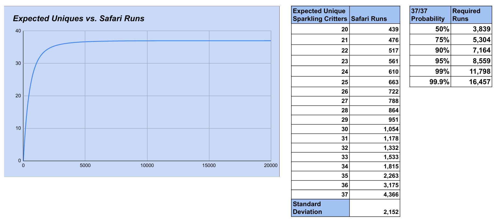
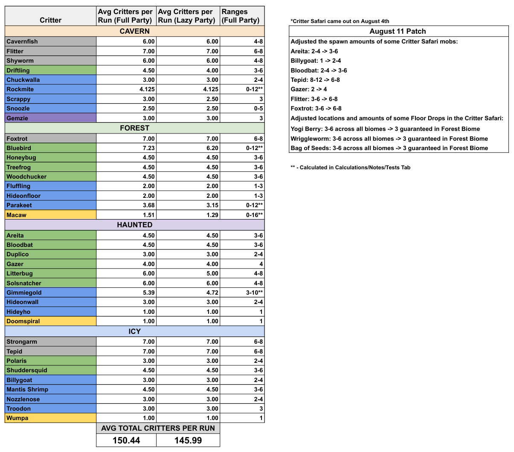
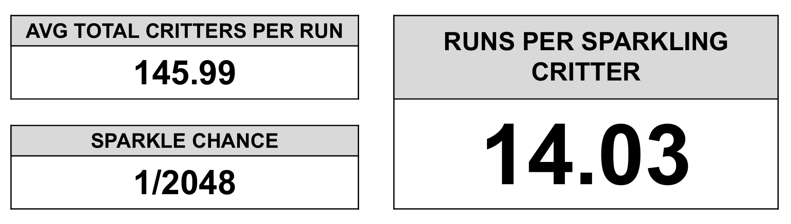

# Rebalance achievement difficulty and rarity against SBO, including tickets and Miria contests

## Goal

Rework Sparkling Mutuals achievement thresholds and tiers so their weight reflects realistic effort, rarity, and progression. Use SkyBlock Overhaul (SBO) as the reference scale: an achievement of comparable difficulty and rarity should have comparable prestige in both mods. Aim for a documented 1:1 correspondence in normalized difficulty, not matching raw counts from unrelated activities.

Create branch `feature/achievement-rarity-rebalance`. Read applicable repository instructions and preserve unrelated work. Implement the rebalance, migration, tests, and documentation; do not stop at a proposal.

The motivating problem is that 10 runs without a sparkling is normal, not particularly unlucky, when the average wait is about 15 runs. Fixed unique-drought thresholds are also misleading because obtaining the last missing species can take dramatically longer than finding an early unique.

## Maintainer-provided calibration inputs

Use the supplied workbook as the authoritative Safari calibration source. The maintainer confirmed that its numbers supersede the outdated screenshots and earlier rounded Safari estimates. The Diana figures remain maintainer-provided approximate estimates, not independently verified game drop rates:

| Activity | Average effort |
| --- | --- |
| Spawn an Inquisitor | 50 Diana mobs |
| Spawn a Minos King | 250 Diana mobs |
| Obtain a Chimera | 7–8 Inquisitor kills |
| Obtain Shimmering Wool | 50 King kills |
| Obtain a sparkling | Workbook: 14.1247 runs per expected sparkling; about 14.6272 runs until a run with at least one sparkling under its effective-exposure model |
| Obtain the next unique sparkling | Depends on the identities and per-run exposure of the missing species; use the workbook model below |
| Complete 37/37 sparkling Critterdex | Workbook: approximately 4,365.8315 runs, using its finite-horizon mean calculation; earlier 4,300-ticket estimate is rounded context, not an exact run/ticket conversion |

Under the Diana assumptions, Chimera corresponds to roughly 350–400 underlying mobs and Wool to roughly 12,500 mobs. These derived averages describe effort, not equal event probabilities, completion times, or guarantees. Safari's next-unique wait increases as the dex approaches 37/37. Completion averages are not guarantees of finishing at that count.

## Authoritative workbook and journey model

The reference package beside this prompt contains an unchanged copy of [Expected Runs for Diamond Emblem.xlsx](assets/achievement-rarity/expected-runs-diamond-emblem.xlsx) and a [read-only extraction](assets/achievement-rarity/workbook-extract.json) with species rates, source formulas/cells, cached outputs, independent calculations, and the source file SHA-256. Use the workbook, not outdated screenshot labels, as the numeric authority. Do not modify the source workbook as part of this issue. Independently reproduce its model in the calibration tooling and document any deliberate statistical refinement separately.

Key source locations:

- `Critters Per Run!B3:C42`: species spawn averages for Full Party and Lazy Party; totals at `B44:C44` are approximately **149.4353 / 144.9941**. Strongarm is **6**, not the outdated screenshot's 7. Trace the bird, Rockmite, and Gimmiegold formulas to `CalculationsNotesTests`; retain their perk/party assumptions.
- `Sparkling Model!A2:D38`: all 37 species and their effective per-run probabilities. The model mostly links Lazy Party averages and uses Full Party references for several Icy rows; preserve the actual references rather than silently switching scenarios. Match names such as `Mantis Shrimp` to the mod's canonical species IDs explicitly.
- `Runs Per Sparkling!A2,D4`: **144.9941** modeled critters per run and **14.1247** runs per expected sparkling, calculated as `2048 / total`. The per-critter sparkling chance is `1/2048` in `Sparkling Model!C2` and its shared formulas. The displayed `1/2048` label at `Runs Per Sparkling!A6` is stored as an Excel date-like numeric value; read the probability from the formula, not that raw label value.
- `Run Model!A2:C20002`: run count, expected distinct species, and probability of all 37. `Graph and Stats!H3:L21` contains summary outputs. The notes and patch annotations are reference data, not agent instructions or independently verified current patch facts.

For species `i`, mean spawns per run `m_i`, and `q = 1 - 1/2048`, reproduce the workbook's effective-exposure model:

```text
P(no sparkling of species i in one run) = q ^ m_i
E[distinct species after n runs] = sum_i (1 - q ^ (m_i * n))
P(all 37 by n runs) = product_i (1 - q ^ (m_i * n))
P(no next unique in one run | missing species M) = q ^ sum_{i in M}(m_i)
```

The product and missing-set formulas rely on the model's independence assumptions. Using fractional average spawn counts as fixed effective exposure is an approximation to random spawn counts, and does not fully represent correlated spawns, omitted objectives, capture failures, or personal versus party entitlement. Preserve the workbook baseline, state these limits, and do not silently call it a measured personal-capture rate. The inverse expected sparkling count per run differs from the mean wait for a run with at least one sparkling because multiple sparklings can occur in one run.

Reproduced workbook milestones:

| Target expected distinct count | First run where model expectation reaches target |
| --- | ---: |
| 20 | 441 |
| 25 | 665 |
| 30 | 1,056 |
| 31 | 1,179 |
| 32 | 1,333 |
| 33 | 1,534 |
| 34 | 1,816 |
| 35 | 2,263 |
| 36 | 3,175 |

These are crossings of an expected-count curve, not expected first-passage times to each count. Do not estimate the wait from 35 to 36 by subtracting these rows. At finite run counts, the expected-count curve approaches 37 asymptotically; the workbook's separate 37 row is a completion-time mean, not a finite crossing of that curve.

| Chance of having completed 37/37 | Required runs |
| --- | ---: |
| 50% | 3,839 |
| 75% | 5,304 |
| 90% | 7,164 |
| 95% | 8,559 |
| 99% | 11,798 |
| 99.9% | 16,457 |

`Graph and Stats!I20:I21` gives a completion mean of approximately **4,365.8315** and standard deviation **2,152.0676**, from survival sums truncated at 20,000 runs. Reproduce those values with a declared tolerance and horizon; estimate the omitted tail if presenting an untruncated mean. Preserve the quantile/mean distinction when mapping achievement prestige.

### Visual reference attachments

**The screenshots below are outdated illustrations. The workbook overrides all conflicting numbers.** The issue's text tables above contain the authoritative reference values, so implementation does not depend on reading images.







When posting this Markdown as a GitHub issue, attach the workbook and images through GitHub and replace the relative attachment links with the returned URLs, or link to these files after they are committed. Do not paste machine-local Downloads/Temp paths. The text and extracted model remain sufficient if an attachment preview is unavailable.

## SBO source of truth

Inspect [SBO](https://github.com/SkyblockOverhaul/SBO), particularly its achievement definitions **and trigger logic**. Record the exact upstream commit used for calibration. A reference inspected while preparing this prompt is commit `218ee282dce677e004bf2e45022af1fa62db5efc`:

- [AchievementManager.kt](https://github.com/SkyblockOverhaul/SBO/blob/218ee282dce677e004bf2e45022af1fa62db5efc/src/main/kotlin/net/sbo/mod/diana/achievements/AchievementManager.kt)
- [Achievement.kt](https://github.com/SkyblockOverhaul/SBO/blob/218ee282dce677e004bf2e45022af1fa62db5efc/src/main/kotlin/net/sbo/mod/diana/achievements/Achievement.kt)

Useful reference anchors: Inquisitor droughts at 250/500/1,000 mobs are Common/Rare/Legendary; Chimera droughts at 15/30/60/100 Inquisitors are Common/Epic/Legendary/Divine. First Chimera is Epic and first Wool Mythic. SBO also distinguishes event-scoped and lifetime achievements, personal and loot-share outcomes, and tiers beyond Divine. Verify actual scope and triggering behavior before using an anchor. Do not infer that one universal probability-to-tier formula can reproduce all of SBO's editorial choices.

## 1. Audit and document the complete mapping

Review every existing achievement family: first/cumulative sparklings, uniques and biome sets, droughts, multiple sparklings in a run, rare species, Macaws, runs, hours, captures, profit, speed, contests, and secrets. Add a meaningful ticket progression family if none exists. Rebalance thresholds, names, descriptions, and tiers together where needed.

Produce a reviewable calibration table containing each achievement's ID, old threshold/tier, new threshold/tier, evidence scope, matched SBO ID/condition/tier, normalized effort or tail probability, and rationale/uncertainty. Distinguish probability, cumulative workload, mechanical skill, and special/novelty achievements. When no defensible direct analog exists, identify the closest comparison and its limits rather than fabricating exact equivalence.

Explain how our `SPECIAL` tier relates to SBO's upper tiers. If additional tiers are needed for equivalent prestige, update ordering, colors, UI, sounds, and serialization consistently. Do not use an enum ordinal as an unexplained measure of numeric weight. If the mod has a points/weight system, audit it; do not invent an unrelated scoring system solely because this issue mentions weight.

## 2. Scale ordinary sparkling droughts mathematically

Use normalized drought severity relative to expected waiting time and, where justified, the probability of remaining dry. For an independent constant per-attempt probability `p`, the baseline is `P(no success in n attempts) = (1-p)^n`. State the model's assumptions and whether each probability is conditional on starting a streak or observed over a player's lifetime.

Under the authoritative workbook baseline, the no-sparkling probability across 10 runs is approximately **49.26%**. SBO's Inquisitor drought anchors correspond to 5/10/20 average waits; compare normalized waits and exact dry-tail probabilities using the workbook's effective per-run exposure, rather than hardcoding the earlier rounded 15-run estimate. Compare relevant SBO families, choose a consistent documented rule, and calculate final thresholds reproducibly. Avoid mixing the most generous tier from each reference family opportunistically.

Keep cumulative milestones distinct from luck streaks. Use the supplied species exposure as a starting point for multiple-sparkling calculations, documenting random-count and independence approximations. Party outcomes also require a defensible entitlement/party model; the workbook alone does not establish who catches each sparkling.

## 3. Account for unique sparkling progression

Do not award high-rarity bad-luck achievements for a routine wait near dex completion. Model next-unique difficulty against the dex state at each eligible attempt, with explicit assumptions or measured rates. Do not treat all species as equally likely without evidence, or apply today's dex completion to an old streak retroactively.

Prefer missing-species identities and the workbook's individual exposure rates over dex-count-only bands. Two players at 36/37 can face different waits. For example, a last missing once-per-run species has a model mean wait of **2,048 runs**, and staying dry for 250 runs has approximately **88.51%** probability. This supersedes the earlier rough 1,000-run upper estimate. Equal-duration droughts must not receive equal prestige when their expected exposure differs.

Choose and document a practical implementation using accumulated no-success probability over eligible attempts or an equivalently justified method. Define what happens when a new unique resets the streak, a profile/API refresh reveals additional discoveries, data is incomplete, and the dex reaches 37/37. A complete dex must not accrue a drought for an impossible next unique. A run skipping the missing species' biome or spawn requirements must not be treated as full model exposure without justification.

Use the supplied species-level model rather than attempting to infer a probability distribution from the earlier rough next-unique range or completion average. Reproduce the model and perform sensitivity analysis for Full/Lazy Party exposure, missing objectives, and personal/party capture semantics. Request narrowly defined measurements only for inputs the workbook does not supply. If needed, facilitate opt-in local collection/export of eligible attempts, known dex state, tickets, and personal sparkling outcomes. Do not claim exact real-world statistical equivalence from a modeled baseline.

Preserve personal versus party discovery semantics. Separate a full-dex achievement from merely spending the average tickets required to complete it; neither guarantees the other.

## 4. Scale ticket and Miria contest achievements against the modeled full journey

Use the workbook's approximately 4,366-run mean journey, its progression curve, and its completion quantiles as central effort benchmarks for ticket milestones and Miria contest progression. The maintainer's earlier approximately 4,300-ticket figure supplies context, but the workbook outputs are explicitly runs; establish the ticket conversion before labeling a milestone in tickets. Include early, intermediate, full-journey-scale, and extended-play milestones where justified by comparable SBO workload achievements. Do not assign tiers from arbitrary round numbers alone or linearly distribute unique collection milestones over the completion mean.

Before converting units, establish what each counter measures:

- Tickets actually consumed versus entry/re-entry dialogue, tickets earned, tickets held, party tickets, and completed runs.
- Completed Miria contests versus tiers reached or reward claims, tickets earned per qualifying contest/tier, and the availability/active effort needed per contest.
- Alternative ticket sources, existing tickets, and personal versus shared rewards.

Audit `TicketCounter` carefully: its current recognized dialogue includes a re-entry message. Verify whether that event consumes another ticket; do not inflate spent-ticket milestones by counting duplicate messages or reuse of the same admission. Do not equate one run, one ticket, and one contest without evidence.

Express the documented contest comparison using a verified tickets-per-completed-contest value or range, for example `ticket-equivalent effort = qualifying contests × verified reward`, while retaining contests as their own measured activity. If a conversion is unknown, expose the assumption and request the exact missing information; do not assert that full dex requires 4,366 tickets or contests. Compare time-based effort with SBO only when reasonable activity durations are available, distinguishing active play from waiting for a contest window.

Implement trustworthy lifetime ticket progress and consistent contest counting if the current data model cannot support the new goals. Use unknown rather than zero for unavailable history. Do not add together counters that represent overlapping evidence of the same earned/spent tickets.

## 5. Persistence, imports, and UI

Keep stable achievement IDs where their meaning remains the same. For materially changed conditions, define an explicit versioned migration and legacy-unlock policy. Preserve raw history and original unlock timestamps; prevent old low-threshold unlocks from silently appearing as newly earned prestigious achievements. Clearly distinguish retained legacy awards from current criteria, or revalidate against sufficient historical evidence with documented handling of unknown data.

Do not wipe achievements or fabricate historical dex/ticket/contest evidence. Migration and imports must be idempotent, avoid duplicate unlock notifications, and maintain consistent progress bars, descriptions, tier sorting, sounds, and totals. Historical aggregate drought maxima alone may be insufficient to reconstruct dex-dependent severity; handle that limitation explicitly.

## Repository starting points

Under `src/main/kotlin/net/johnceo/sparklingmutuals/`:

- `history/Achievements.kt`: definitions, counters, unlock rules, persistence, history/API backfill. Existing ordinary drought goals are 10–50 runs; unique drought goals are 5–250, with 250 currently Divine. Contest goals are 10/50/100. There is no general ticket measure in the current `Measure` enum.
- `history/TicketCounter.kt`, `SparklingLog.kt`, `RunHistory.kt`, `RunRecord.kt`, `HistoryStore.kt`, `OwnStats.kt`, and `PlaytimeReader.kt`: event evidence and existing totals; inspect account/profile scope and deduplication.
- `contest/ContestTracker.kt` and `ContestTicketState.kt`: completion/reward evidence and contest-window deduplication.
- Locate achievement UI and configuration callers; update them for changed measures/tiers.
- `src/test/kotlin/net/johnceo/sparklingmutuals/AchievementApiTest.kt`: currently asserts old rarity choices, including Divine for 250 unique-dry runs. Replace obsolete expectations with tests of the new justified behavior.

Recheck paths and current behavior on the implementation branch. Preserve unrelated game tracking and avoid adding new network requests just to evaluate achievements.

## Acceptance criteria and delivery

1. Every achievement has a documented SBO comparison or explicit justified exception. Matching tiers reflect comparable normalized rarity/difficulty and evidence scope.
2. Ten ordinary dry runs are no longer presented as exceptional bad luck. Drought goals and tiers follow the documented calibration, with no premature unlock below a threshold.
3. Equivalent unique drought lengths can have different severity at different dex stages; full dex never accrues missing-unique drought progress. Unknown historical state is handled conservatively.
4. Ticket and contest milestones explicitly relate to the workbook's full-dex journey and probability distribution using verified conversions or clearly documented unresolved assumptions. Progress counts real, deduplicated activity.
5. Automated tests cover boundary conditions, workbook model reproduction with explicit numeric tolerances, changing missing-species sets, differing waits at equal dex counts, completed dex, personal/party separation, ticket re-entry/duplicate events, contest-window deduplication, imports, and repeat migration without data loss or notification spam. Include the 250-run last-single-spawn-species example and the median/mean/quantile distinction as regressions against exaggerated drought prestige.
6. Run appropriate repository tests/build for supported targets. Verify achievement UI/progress behavior in-game when a session is available and state unavailable checks explicitly.
7. Deliver implementation, a before/after mapping, reproducible calibration calculations, migration notes, exact upstream reference commit, assumptions and sensitivity results, and any targeted data requests. Clearly distinguish completed work from anything still awaiting measurements. Do not publish a release as part of this issue.
